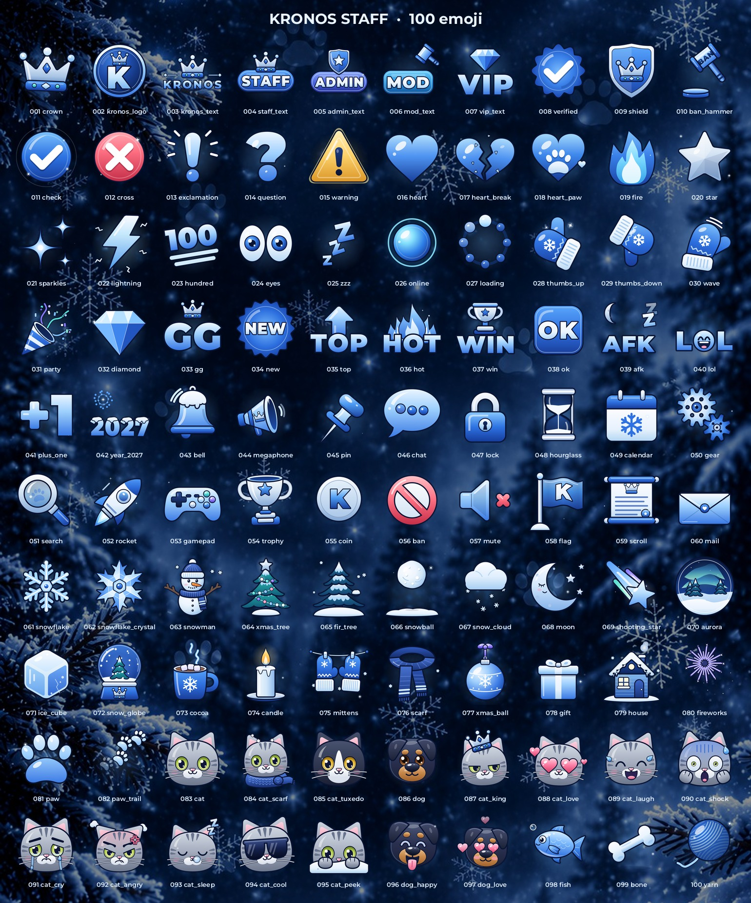

# KRONOS STAFF — 100 эмодзи для Telegram

Набор из 100 кастомных эмодзи в стиле аватарки и фона KRONOS STAFF: ночной зимний лес,
ледяной синий, снег, искры, корона, коты и ротвейлер.



## Что лежит в `dist/`

| Папка / файл | Что это |
|---|---|
| `tgs/` | 100 анимированных эмодзи (TGS: 512×512, 60 к/с, петля 2–3 с, 1.5–11 КБ) |
| `png/` | 100 статичных эмодзи PNG 100×100 — формат Telegram для статичных эмодзи |
| `png512/` | те же кадры 512×512 (например, для стикеров) |
| `emoji_list.md`, `emoji_list.csv` | номер, файл, какой обычный эмодзи привязать в @Stickers |
| `preview/all_emoji.jpg`, `preview/all_emoji.mp4` | общий лист и видео со всеми анимациями |
| `KRONOS_STAFF_emoji.zip` | всё вместе одним архивом (создаётся `package.py`, в git не хранится) |

Категории: 001–010 бренд и роли, 011–032 реакции и символы, 033–042 текстовые плашки,
043–060 инструменты и модерация, 061–080 зима, 081–100 коты, собаки и лапки.

## Как загрузить в Telegram

1. Откройте бота [@Stickers](https://t.me/Stickers) и отправьте `/newemojipack`.
2. Выберите тип «Анимированные эмодзи» и придумайте название набора.
3. Отправьте файл из `dist/tgs` (как файл), затем обычный эмодзи из `dist/emoji_list.md`.
4. Повторите для остальных файлов — порядок отправки станет порядком в наборе.
5. `/publish` → `/skip` (иконка) → короткое имя, например `kronos_staff`.
   Ссылка на набор будет `t.me/addemoji/kronos_staff`.

Статичный набор делается так же: тип «Статичные эмодзи» и файлы из `dist/png`.
Отправлять эмодзи в сообщениях могут пользователи с Telegram Premium, видят их все.

## Требования Telegram, которые проверяет `validate.py`

Холст 512×512, 60 к/с, не длиннее 3 секунд, не больше 64 КБ, петля без рывка, ничего не
выходит за холст ни в одном кадре, нет запрещённых возможностей Lottie (маски, матты,
эффекты, выражения, текстовые слои, картинки, звёзды, повторители, градиентные обводки, скос).
Рендер проверяется движком rlottie — тем же, что в приложениях Telegram.

## Как пересобрать или поменять

```bash
python3 -m venv .venv && .venv/bin/pip install -r requirements.txt
.venv/bin/python build.py              # все эмодзи → dist/ (или --only 1-10,33)
.venv/bin/python validate.py           # проверка правил Telegram
.venv/bin/python preview.py --only 1-6 # проверочный лист кадров → /tmp
.venv/bin/python preview.py --sheet    # общий лист dist/preview/all_emoji.jpg
.venv/bin/python preview.py --video    # видео dist/preview/all_emoji.mp4
.venv/bin/python package.py            # архив dist/KRONOS_STAFF_emoji.zip
```

Каждый эмодзи — функция на Python в `emojis/` (по файлу на категорию), которая собирает
Lottie из фигур, градиентов и ключевых кадров с плавными кривыми. Общие инструменты — в
`kit/` (геометрия и SVG-пути, эффекты: блики, искры, снег, свечение; текст из шрифта),
правила стиля — в `docs/STYLE.md`.

Шрифт Montserrat распространяется по лицензии SIL Open Font License (`fonts/OFL.txt`).
